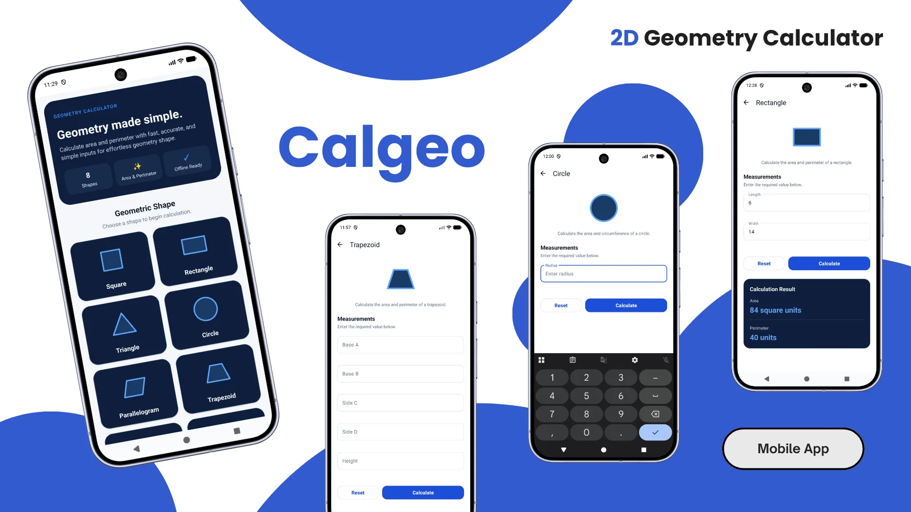
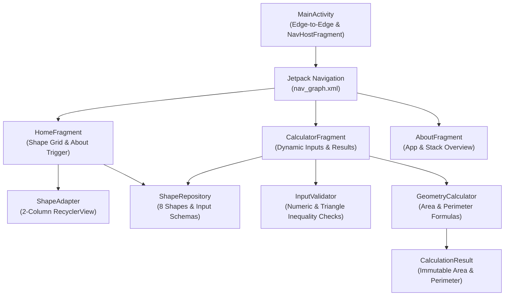
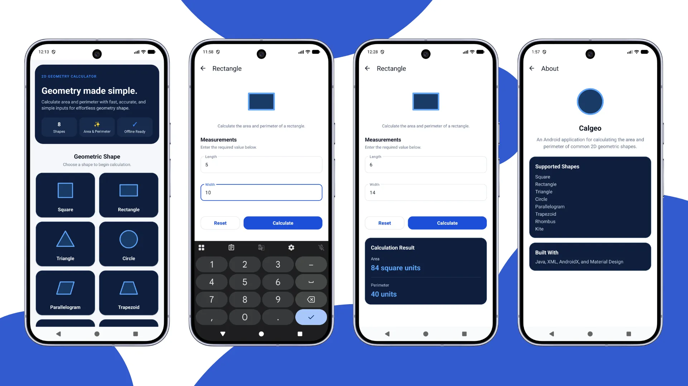

# Calgeo - 2D Geometry Calculator




## Project Overview

Calgeo is an offline native Android application written in Java for calculating the area, perimeter, and circumference of eight common 2D geometric shapes. It addresses the everyday need of students, educators, and technical users for a fast, distraction-free geometry utility that does not require manual formula lookup or network connectivity. By pairing dynamic per-shape measurement forms with strict numeric and geometric validation, the application ensures accurate results with clean Material Design 3 presentation.

## Key Features

- **Eight Supported 2D Shapes**: Computes area and perimeter (or circumference for circles) for Square, Rectangle, Triangle, Circle, Parallelogram, Trapezoid, Rhombus, and Kite.
- **2-Column Visual Shape Grid**: Presents a hero summary card and a `RecyclerView` grid of custom vector shape cards on the home screen for one-tap navigation.
- **Dynamic Measurement Input Generation**: Dynamically inflates `TextInputLayout` fields tailored to each selected shape's required parameters (from 1 field for Square/Circle up to 5 fields for Trapezoid).
- **Multi-Layer Input & Geometric Validation**: Enforces required-field checks, positive finite decimal parsing, and the triangle inequality theorem ($a + b > c$) with inline field error highlighting and automatic focus scrolling.
- **Formatted Calculation Results & Reset Workflow**: Displays results rounded to up to two decimal places inside a high-contrast result card, supports one-tap form reset, and automatically manages soft-keyboard dismissal.
- **Edge-to-Edge System Insets & DayNight Support**: Applies `WindowCompat` edge-to-edge rendering with safe system bar and display cutout insets, along with light and dark theme resource definitions.
- **100% Offline Operation**: Executes all repository lookups and geometric formulas locally without network permissions or external services.

## Supported Platforms

| Platform | Operating System | Minimum Version | Support / Test Status |
| :--- | :--- | :--- | :--- |
| Mobile (Android) | Android | Android 8.0 (API 26) | Configured (`minSdk = 26`, `targetSdk = 36`, `compileSdk = 37`); not verified on physical release hardware in this audit |

## Tech Stack

| Category | Technology | Purpose |
| :--- | :--- | :--- |
| Programming Language | Java | Core application logic, UI controllers, and geometric formulas (`JavaVersion.VERSION_17`) |
| Mobile Framework | Android SDK & AndroidX | Native activity, fragment lifecycle, window insets, and core UI infrastructure |
| UI Design System | Material Design 3 | `MaterialCardView`, `MaterialToolbar`, `MaterialButton`, `TextInputLayout`, and `Snackbar` components |
| Navigation | Jetpack Navigation Component | Single-activity fragment routing via `NavHostFragment` and `nav_graph.xml` |
| Layout & Binding | ConstraintLayout, RecyclerView, ViewBinding | Responsive XML layouts, 2-column shape grid, and compile-time view references |
| Build & Dependency Tooling | Gradle & Android Gradle Plugin | Kotlin DSL build configuration, version catalog (`libs.versions.toml`), and APK assembly |
| Testing Frameworks | JUnit 4 & Espresso | Local unit test (`ExampleUnitTest`) and Android instrumentation test (`ExampleInstrumentedTest`) scaffolding |

## Application Architecture

Calgeo uses a single-activity, multi-fragment native Android architecture structured around clear separation between UI controllers, static in-memory data definitions, validation rules, and pure calculation utilities. `MainActivity` initializes edge-to-edge window insets and hosts `NavHostFragment` backed by `nav_graph.xml`. `HomeFragment` renders the shape catalog from `ShapeRepository` via `ShapeAdapter` and passes the selected `ShapeType` argument to `CalculatorFragment` or navigates to `AboutFragment`. Inside `CalculatorFragment`, dynamic inputs are inflated from `ShapeRepository`, checked by `InputValidator`, and evaluated by `GeometryCalculator` to return an immutable `CalculationResult`.



## Screenshots / Preview

### 1. End-to-End Mobile Workflow & UI States

A four-screen walkthrough illustrating Calgeo's primary user journey: the Home screen featuring the dark navy hero card and 2-column shape grid, the Rectangle measurement form with an active decimal keypad, the computed Calculation Result card displaying Area (`84 square units`) and Perimeter (`40 units`), and the About screen listing all eight supported shapes and underlying technologies.

## Prerequisites

- **Operating System (Developer)**: Windows, macOS, or Linux capable of running Android Studio and the Android SDK.
- **Java Development Kit**: JDK 17 (required by `sourceCompatibility` and `targetCompatibility` in `app/build.gradle.kts`).
- **Android SDK**: Android SDK Platform 37 (`compileSdk = 37`) and Build-Tools compatible with Android Gradle Plugin `9.3.2`.
- **Build Tooling**: Included Gradle Wrapper (`9.5.0`) via `./gradlew` or `gradlew.bat`.
- **IDE (Recommended)**: Android Studio with Android Emulator or a physical Android device running Android 8.0 (API 26) or higher.

## Installation & Setup

1. Clone the repository to your local machine:
   ```bash
   git clone https://github.com/weztcy/Calgeo-2D-Geometry-Calculator.git
   cd "Calgeo - 2D Geometry Calculator"
   ```
2. Verify that `local.properties` points to your local Android SDK path (or open the root folder in Android Studio to generate `local.properties` automatically):
   ```properties
   sdk.dir=/path/to/your/Android/Sdk
   ```
3. Sync Gradle dependencies and build the debug APK using the Gradle Wrapper:
   ```bash
   ./gradlew assembleDebug
   ```
   On Windows PowerShell or Command Prompt:
   ```powershell
   .\gradlew.bat assembleDebug
   ```
4. Install and launch the debug build on a connected Android device or emulator (API 26+):
   ```bash
   ./gradlew installDebug
   ```

## Application Configuration

No additional external configuration, API keys, or environment files are required to run Calgeo. Build and runtime behavior are controlled directly through the Gradle build script and Android manifest resources:

| Configuration | Description | Default / Example |
| :--- | :--- | :--- |
| `applicationId` | Unique Android application identifier defined in `app/build.gradle.kts` | `com.example.a2dshapecalculatormobileapp` |
| `namespace` | Generated `R` and `ViewBinding` package namespace in `app/build.gradle.kts` | `com.example.calgeo` |
| `minSdk` / `targetSdk` / `compileSdk` | Android API level bounds configured in `app/build.gradle.kts` | `26` / `36` / `37` |
| `sourceCompatibility` / `targetCompatibility` | Java bytecode target configured for compilation | `JavaVersion.VERSION_17` |
| `buildFeatures.viewBinding` | Enables compile-time generated binding classes for XML layouts | `true` |
| `android:allowBackup` & `android:supportsRtl` | Manifest backup and right-to-left layout support flags | `true` |
| `android:theme` | Material 3 DayNight base theme without default action bar | `@style/Theme.A2DShapeCalculatorMobileApp` |

## Testing

The project configures JUnit 4 for local JVM unit testing (`app/src/test/java/com/example/calgeo/ExampleUnitTest.java`) and AndroidX JUnit with Espresso for instrumentation testing (`app/src/androidTest/java/com/example/calgeo/ExampleInstrumentedTest.java`). Test execution was not run in this documentation audit.

- **Local Unit Tests**: JUnit 4 (`junit:junit:4.13.2`) under `app/src/test`.
- **Android Instrumentation Tests**: AndroidX Test Runner, `androidx.test.ext:junit:1.2.1`, and `androidx.test.espresso:espresso-core:3.6.1` under `app/src/androidTest`.

```bash
./gradlew test
./gradlew connectedAndroidTest
```

## Build & Packaging

Calgeo uses Gradle with the Android Gradle Plugin (`9.3.2`) and Kotlin DSL (`app/build.gradle.kts`) to compile Java 17 sources, generate ViewBinding classes, and package Android APK or App Bundle artifacts. ProGuard rules (`app/proguard-rules.pro` and `app/src/main/keepRules/rules.keep`) are declared for release builds (`isMinifyEnabled = false` by default).

1. Build a debug APK for local testing:
   ```bash
   ./gradlew assembleDebug
   ```
2. Build a release APK or Android App Bundle (AAB):
   ```bash
   ./gradlew assembleRelease
   ./gradlew bundleRelease
   ```
3. Inspect generated build artifacts under `app/build/outputs/apk/` or `app/build/outputs/bundle/`.

## Usage

After launching Calgeo on an Android device or emulator (API 26+), all features are immediately accessible offline without sign-in or setup:

1. **Select a 2D Shape**: Browse the 2-column grid on the Home screen (`Square`, `Rectangle`, `Triangle`, `Circle`, `Parallelogram`, `Trapezoid`, `Rhombus`, or `Kite`) and tap a shape card to open its calculator.
2. **Enter Dimensions**: Type positive decimal numbers into the dynamically generated measurement fields; use the keyboard `Next` action to advance between fields and `Done` on the final field to dismiss the keypad.
3. **Calculate Results**: Tap **Calculate** to validate all inputs (including triangle inequality constraints when `Triangle` is selected) and reveal the **Calculation Result** card with **Area** and **Perimeter** (or **Circumference** for `Circle`).
4. **Reset or Navigate**: Tap **Reset** to clear all inputs, error states, and results, tap the toolbar back arrow to choose another shape, or tap **About this app** on the Home screen to inspect supported shapes and build credits.

## Contributing

Contributions to improve shape coverage, unit test depth, or UI accessibility are welcome through a standard pull-request workflow:

1. Fork the repository.
2. Create a feature or fix branch (`git checkout -b feature/your-change`).
3. Implement your changes following the existing package structure (`adapter`, `data`, `model`, `ui`, `util`).
4. Validate your changes by building and running tests (`./gradlew test` and `./gradlew assembleDebug`).
5. Commit and push your branch to your fork.
6. Open a pull request describing the motivation and verification performed.

## License

This project is licensed under the MIT License.
See the [LICENSE](LICENSE) file for details.

## Author & Contact

**Yohanes Dimas Pratama**

- GitHub: [github.com/weztcy](https://github.com/weztcy)
- Portfolio: [yohanesdimas.com](https://yohanesdimas.com)
- LinkedIn: [linkedin.com/in/yohanes-dimas](https://www.linkedin.com/in/yohanes-dimas)
